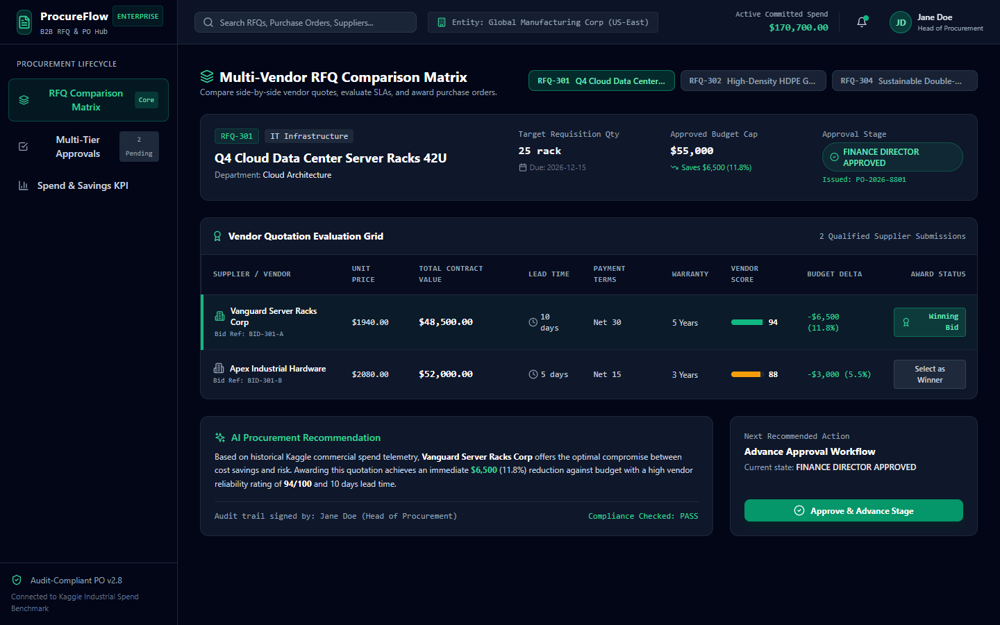
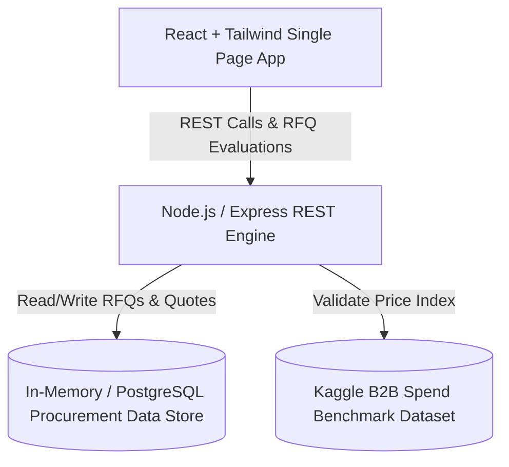

# ProcureFlow — Enterprise Procurement & RFQ Management Platform

[](LICENSE)
[](https://nodejs.org/)
[](https://react.dev/)
[](https://tailwindcss.com/)
[](https://www.docker.com/)
[](data/kaggle_procureflow_rfq_matrix_benchmark.csv)

ProcureFlow is an end-to-end enterprise procurement lifecycle management platform engineered to automate request for quotations (RFQs), multi-vendor bid comparisons, audit-proof multi-tier approval chains, and automated purchase order (PO) generation.

---

## 📸 System Dashboard & RFQ Comparison Matrix



---

## 🌟 Key Capabilities & Standout Features

- **Side-by-Side Vendor Quotation Evaluation**: Compare multiple competing supplier bids across unit cost, total contract value, lead time, payment terms, warranties, and vendor scoring metrics.
- **Budget Variance & Savings Delta**: Automatically calculate monetary and percentage savings against approved departmental budget caps.
- **Audit-Compliant 4-Tier Approval Chains**: Enforce multi-stakeholder governance across **Requisition Submitted**, **Department Head Review**, **Finance Director Approval**, and **PO Dispatched**.
- **Automated Purchase Order Generation**: Instantly issues unique PO reference tokens upon final executive sign-off.
- **Kaggle Industrial Spend Benchmark**: Benchmarks supplier bids against real-world manufacturing and enterprise procurement indices.

---

## 🏛 Architecture Overview



---

## 📊 Dataset Benchmark

The repository includes a curated benchmark in [`data/kaggle_procureflow_rfq_matrix_benchmark.csv`](data/kaggle_procureflow_rfq_matrix_benchmark.csv) covering:
- RFQ reference IDs, category classifications, and operational departments
- Supplier quotes, unit prices, contract totals, and lead times in days
- Payment terms (Net 15, Net 30, Net 45), warranty terms, and compliance ratings
- Budget allocations, cost savings metrics, and approval milestones

---

## 🔌 API Reference

| Endpoint | Method | Description |
| :--- | :--- | :--- |
| `/health` | `GET` | Health check & service status |
| `/api/v1/procurement/metrics` | `GET` | High-level spend, active RFQs, and savings metrics |
| `/api/v1/rfqs` | `GET` | List all active RFQs with supplier bids and approval state |
| `/api/v1/rfqs/:id` | `GET` | Retrieve single RFQ details |
| `/api/v1/rfqs/:id/select-bid` | `POST` | Select and award winning supplier quotation |
| `/api/v1/rfqs/:id/advance-approval` | `POST` | Advance approval stage along governance chain |
| `/api/v1/rfqs` | `POST` | Create a new enterprise procurement requisition |

---

## 🚀 Quickstart Guide

### Option 1: Docker Compose (Recommended)

```bash
docker-compose up --build
```
- Frontend UI: `http://localhost:3003`
- Backend API: `http://localhost:5003`

### Option 2: Local Development

#### 1. Backend Service
```bash
cd backend
npm install
npm run dev
```

#### 2. Frontend Application
```bash
cd frontend
npm install
npm run dev
```

---

## 📄 License
This project is licensed under the MIT License.
